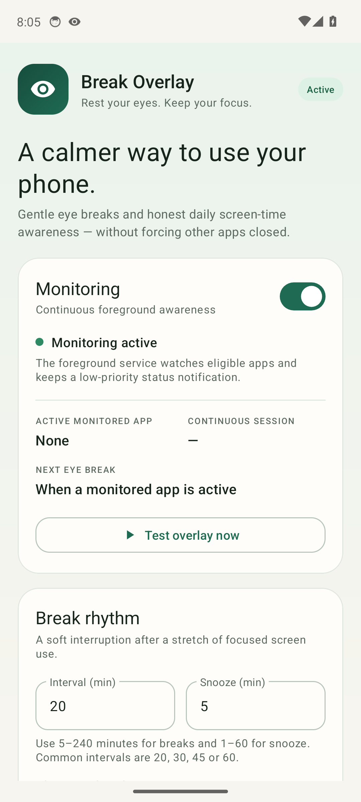
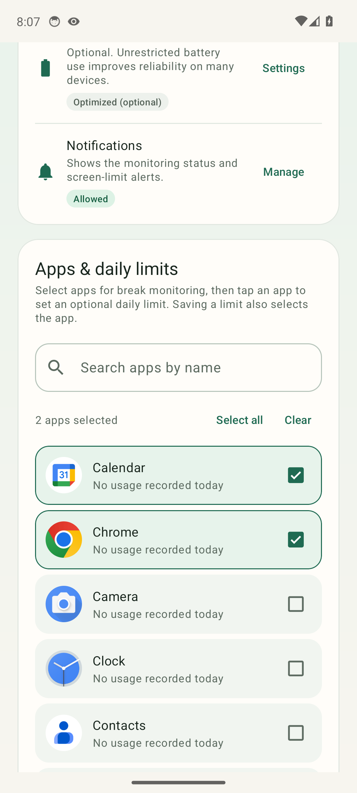
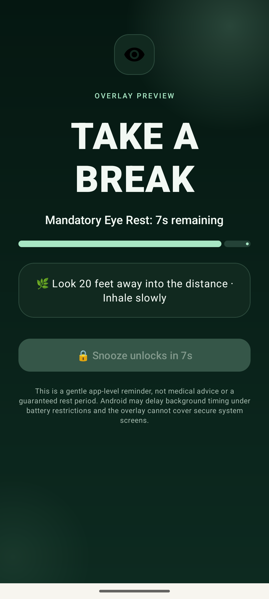

# Break Overlay

**A calm, local-only eye-break and screen-time awareness app for Android.**

Break Overlay watches eligible foreground apps through Android's UsageStats APIs and shows a
full-screen, eight-second rest overlay after a continuous session reaches the interval you choose.
It is not an app blocker: it never closes, force-stops, or prevents another app from running.

[](LICENSE)
[](../../releases/latest)




## Highlights

- **Active-time breaks** — time accrues only while the screen is on, the device is unlocked, and a
  monitored app is in the foreground. Switching between eligible apps keeps one continuous session;
  a gap of up to two minutes pauses it. Screen-off or a longer gap resets it.
- **Full-screen rest overlay** — animated three-stage title, eight-second monotonic countdown,
  progress bar, locked snooze until the rest completes, optional notification chime, and back-key
  blocking while visible.
- **Choose what counts** — monitor all eligible apps or a selected set with search and sorting.
  Launchers, System UI, and Break Overlay itself never count.
- **Daily limits** — set a per-app limit from 1 to 1440 minutes. One notification is posted per app
  per local day when reconstructed usage reaches the limit.
- **Honest usage totals** — daily usage is reconstructed from Android `UsageEvents` and clipped to
  local midnight. Totals are marked with `~` when they are estimates from incomplete or ongoing
  sessions.
- **Real permission state** — Usage access and overlay permission are rechecked every time the
  dashboard resumes. There are no placeholder statuses.
- **Local-only** — no account, analytics, network permission, or cloud sync. Settings, app
  selections, limits, and schedule state are stored in AndroidX DataStore.
- **Recovery and preview isolation** — monitoring recovers after a process restart and best-effort
  after reboot. The overlay preview does not charge time to the real session or daily limits.

## Screenshots

| App selection and limits | Break overlay |
| --- | --- |
|  |  |

## Install

Download the latest signed APK from [Releases](../../releases/latest):

- Artifact: `BreakOverlay-1.0.1-release.apk`
- Package: `com.breakoverlay.app`
- Minimum Android: 7.0 / API 24
- Compile and target SDK: 34
- Size: about **5.4 MB**
- ABIs: universal APK with `arm64-v8a`, `armeabi-v7a`, `x86`, and `x86_64` native helpers
- Signing: APK Signature Scheme v2 with a local release key (not a Play Store key)

```bash
adb install -r BreakOverlay-1.0.1-release.apk
```

The debug and release builds use the same package ID, so install one at a time. If more than one
device is connected, pass `-s <serial>` to `adb`. Enable USB debugging and accept the computer's RSA
fingerprint on the phone first.

## Using the app

1. Open **Break Overlay**.
2. Grant **Usage access** and **Display over other apps** under **Permissions & access**. Allow
   notifications so the monitoring status and limit alerts can appear.
3. Choose **All apps** or **Selected apps only**. In selected mode, search for and check the apps
   that should count.
4. Set the break interval (5–240 minutes) and snooze length (1–60 minutes), then tap **Apply break
   settings**.
5. Turn on **Monitoring**.
6. Use **Test overlay now** to preview the overlay. It uses the real overlay UI but is isolated from
   the real break session and daily limits.

Tap an app row to set an optional daily limit. Saving a limit also selects that app for monitoring.
The overlay's snooze button unlocks after the eight-second rest and adds the configured snooze time
to the next active-time threshold.

## Build from source

Requirements:

- JDK 17
- Android SDK with platform 34 and build-tools 34.0.0
- `ANDROID_HOME` or `ANDROID_SDK_ROOT`, or an SDK at `$HOME/Android/Sdk`

```bash
git clone https://github.com/SaiKishore6336/BreakOverlay.git
cd BreakOverlay
./gradlew testDebugUnitTest
./gradlew testReleaseUnitTest
./gradlew lintDebug
./gradlew lintRelease
./gradlew assembleDebug
./gradlew assembleRelease
```

A debug-only helper is also available:

```bash
./build_apk.sh
```

Outputs:

- Release APK: `app/build/outputs/apk/release/app-release.apk`
- Debug APK: `app/build/outputs/apk/debug/app-debug.apk`
- Test reports: `app/build/reports/tests/`
- Lint reports: `app/build/reports/lint-results-*.html`

## Release signing

Release signing is read from a repository-root `keystore.properties` file. The real file and the
`keystore/` directory are ignored by Git. Use `keystore.properties.example` as the template:

```bash
mkdir -p keystore
keytool -genkeypair \
  -keystore keystore/breakoverlay-release.jks \
  -alias breakoverlay \
  -keyalg RSA -keysize 4096 -validity 10000
cp keystore.properties.example keystore.properties
# Edit keystore.properties with the same passwords and alias.
./gradlew assembleRelease
```

If `keystore.properties` is absent, the release task produces an unsigned APK; it does not fall back
to a debug key. Keep the keystore and passwords backed up and private. Android only accepts updates
to the same package when they are signed with the same key.

The published 1.0.1 APK is signed with a dedicated local release key. It is suitable for sideloading
and personal use, not for Google Play or another store.

## Limits and notes

- An overlay cannot cover the secure keyguard, permission dialogs, or secure system windows.
- Break timing is best effort. Doze, App Standby, aggressive OEM task managers, battery
  restrictions, and Android background-start rules can delay or stop the foreground service. The
  dashboard distinguishes "monitoring enabled" from "service actually running".
- UsageStats is not a perfect real-time API. Reconstructed totals can differ from Digital Wellbeing,
  especially for sessions that began before the query window, inferred unlock sessions, or sessions
  still open at query time.
- Daily limits produce a notification. Android does not allow a normal third-party app to
  force-close another app, so Break Overlay does not pretend to block one.
- The overlay chime follows the device's notification sound and volume. Silent mode and Do Not
  Disturb are respected.
- If you do not tap snooze after the countdown, the overlay remains until you snooze or stop
  monitoring.
- The release APK is not minified. It was tested by installing and launching it on a clean Android
  14 x86_64 emulator, enabling monitoring, checking the app list, and opening the overlay preview.
  Physical-device testing on OEM builds is still recommended.

## Project layout

```text
app/src/main/java/com/breakoverlay/app/
├── MainActivity.kt                 Dashboard, permissions, app list, settings, preview
├── apps/AppListRepository.kt       Launchable-app discovery and exclusions
├── data/                           AppPreferences and DataStore repository
├── domain/                         Limits, day keys, ranges, formatting, sorting
├── notifications/                  Channels and notification builders
├── overlay/                        Overlay lifecycle, countdown, sound, preview flag
├── receivers/BootReceiver.kt       Boot-time restart policy
├── scheduler/                      Active-time scheduler and boot recovery
├── service/                        Foreground monitoring loop and status bus
├── usage/                          UsageEvents reconstruction and repository
└── util/                           Permission and boot-count helpers

app/src/test/                       59 unit tests across data, domain, scheduling, usage
app/src/main/assets/licenses/       Notices and license text shipped in the APK
docs/                               Real emulator screenshots
licenses/                           Full third-party license texts
```

## License

Original app code and UI are **MIT-licensed**, copyright © 2026 Sai Kishore. See [LICENSE](LICENSE).

Third-party components are listed in [NOTICE](NOTICE), with full license texts in
[licenses/](licenses/). The APK also contains copies under `assets/licenses/`. All bundled runtime
components are Apache-2.0; there are no LGPL or GPL components in this project.
